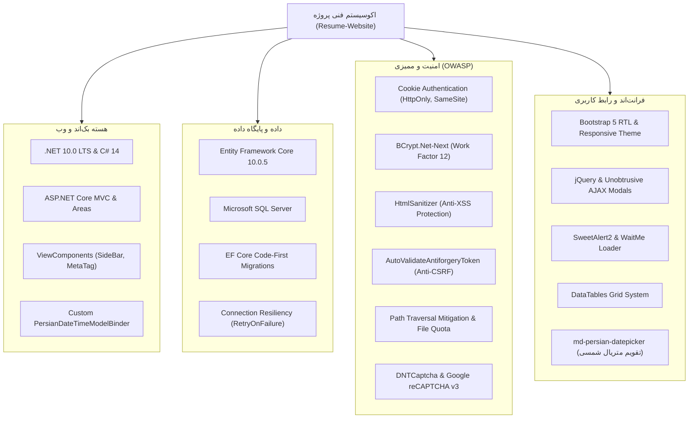
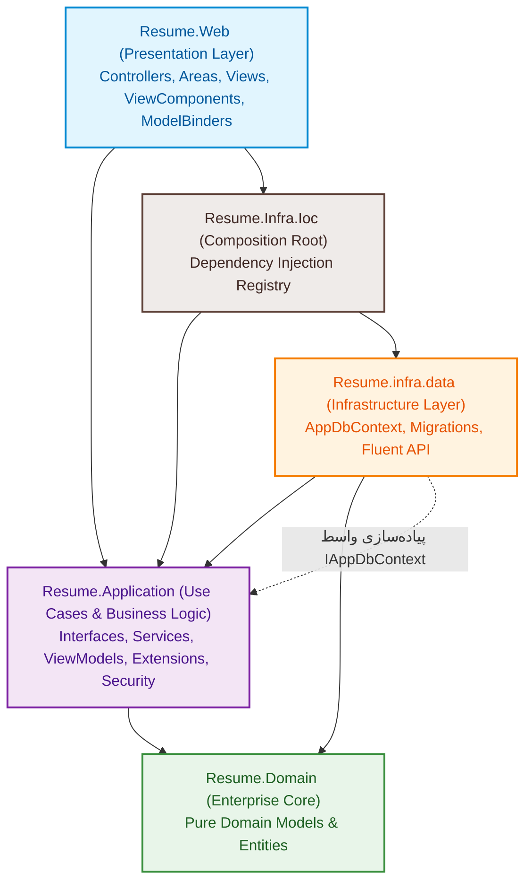

# وب‌سایت رزومه و پورتفولیو حرفه‌ای (Professional Resume & Portfolio Website)
### سامانه مدیریت رزومه، معرفی خدمات و نمونه‌کارها مبتنی بر دات‌نت ۱۰ و معماری تمیز (Clean Architecture)

---

## فهرست مطالب (Table of Contents)
- [۱. معرفی و کاربرد پروژه (Project Introduction & Purpose)](#۱-معرفی-و-کاربرد-پروژه-project-introduction--purpose)
  - [۱.۱. چرایی و اهداف توسعه](#۱۱-چرایی-و-اهداف-توسعه)
  - [۱.۲. جامعه مخاطبان و سناریوهای کاربرد](#۱۲-جامعه-مخاطبان-و-سناریوهای-کاربرد)
  - [۱.۳. چه مشکلی با این سامانه حل می‌شود؟](#۱۳-چه-مشکلی-با-این-سامانه-حل-می‌شود)
- [۲. تکنولوژی‌ها و ابزارهای مورد استفاده (Technologies & Tools)](#۲-تکنولوژی‌ها-و-ابزارهای-مورد-استفاده-technologies--tools)
  - [۲.۱. هسته بک‌اند و فریم‌ورک اصلی](#۲۱-هسته-بک‌اند-و-فریم‌ورک-اصلی)
  - [۲.۲. لایه داده و پایگاه داده](#۲۲-لایه-داده-و-پایگاه-داده)
  - [۲.۳. امنیت و رمزنگاری](#۲۳-امنیت-و-رمزنگاری)
  - [۲.۴. لایه فرانت‌اند و رابط کاربری](#۲۴-لایه-فرانت‌اند-و-رابط-کاربری)
  - [۲.۵. ابزارهای بومی‌سازی و تاریخ شمسی](#۲۵-ابزارهای-بومی‌سازی-و-تاریخ-شمسی)
- [۳. معماری نرم‌افزار (Software Architecture)](#۳-معماری-نرم‌افزار-software-architecture)
  - [۳.۱. اصول معماری تمیز (Clean Architecture Principles)](#۳۱-اصول-معماری-تمیز-clean-architecture-principles)
  - [۳.۲. نمودار جریان و وابستگی لایه‌ها](#۳۲-نمودار-جریان-و-وابستگی-لایه‌ها)
  - [۳.۳. تشریح وظایف لایه‌ها و پروژه‌ها](#۳۳-تشریح-وظایف-لایه‌ها-و-پروژه‌ها)
- [۴. ویژگی‌های کلیدی و قابلیت‌های فنی (Key Features)](#۴-ویژگی‌های-کلیدی-و-قابلیت‌های-فنی-key-features)
  - [۴.۱. مدیریت داینامیک اطلاعات فردی و بیوگرافی (Dynamic About Me)](#۴۱-مدیریت-داینامیک-اطلاعات-فردی-و-بیوگرافی-dynamic-about-me)
  - [۴.۲. احراز هویت سبک و امن ادمین با Cookie Authentication](#۴۲-احراز-هویت-سبک-و-امن-ادمین-با-cookie-authentication)
  - [۴.۳. امنیت پیشرفته در آپلود فایل‌ها (File Upload Hardening)](#۴۳-امنیت-پیشرفته-در-آپلود-فایل‌ها-file-upload-hardening)
  - [۴.۴. ایمن‌سازی سراسری در برابر حملات CSRF و XSS](#۴۴-ایمن‌سازی-سراسری-در-برابر-حملات-csrf-و-xss)
  - [۴.۵. تبدیل و یکپارچه‌سازی تاریخ شمسی با Model Binder اختصاصی](#۴۵-تبدیل-و-یکپارچه‌سازی-تاریخ-شمسی-با-model-binder-اختصاصی)
  - [۴.۶. تجربه کاربری روان با عملیات ناهمگام و مودال‌های آژاکسی (AJAX CRUD)](#۴۶-تجربه-کاربری-روان-با-عملیات-ناهمگام-و-مودال‌های-آژاکسی-ajax-crud)
  - [۴.۷. سیستم دریافت و مدیریت پیام‌های تماس با ما](#۴۷-سیستم-دریافت-و-مدیریت-پیام‌های-تماس-با-ما)
  - [۴.۸. بهینه‌سازی موتورهای جستجو (SEO) و ViewComponentها](#۴۸-بهینه‌سازی-موتورهای-جستجو-seo-و-viewcomponentها)
- [۵. ساختار فولدربندی پروژه (Project Structure)](#۵-ساختار-فولدربندی-پروژه-project-structure)
- [۶. راهنمای نصب و راه‌اندازی (Getting Started & Setup)](#۶-راهنمای-نصب-و-راه‌اندازی-getting-started--setup)
  - [۶.۱. پیش‌نیازها](#۶۱-پیش‌نیازها)
  - [۶.۲. مراحل گام‌به‌گام پیکربندی و اجرا](#۶۲-مراحل-گام‌به‌گام-پیکربندی-و-اجرا)
  - [۶.۳. اطلاعات حساب کاربری پیش‌فرض ادمین](#۶۳-اطلاعات-حساب-کاربری-پیش‌فرض-ادمین)

---

## ۱. معرفی و کاربرد پروژه (Project Introduction & Purpose)

پروژه **Resume-Website** یک پلتفرم جامع، مدرن و کاملاً داینامیک برای مدیریت و نمایش رزومه حرفه‌ای، سوابق کاری، تحصیلات، مهارت‌های تخصصی، نمونه‌کارها (پورتفولیو)، توصیه‌نامه‌های کارفرمایان و راه‌های ارتباطی است. این پروژه بر پایه جدیدترین نسل فریم‌ورک مایکروسافت، **.NET 10.0**، و منطبق بر اصول **Clean Architecture** و استانداردهای ممیزی امنیت وب (OWASP) پیاده‌سازی شده است.

### ۱.۱. چرایی و اهداف توسعه
هدف از پایه‌ریزی این پروژه، فراتر از یک وبلاگ یا صفحه رزومه ایستا بوده است:
1. **ارائه یک الگوی معماری استاندارد (Reference Architecture):** نمایش چگونگی سازمان‌دهی یک اپلیکیشن مقیاس‌پذیر، قابل نگهداری (Maintainable) و قابل تست (Testable) بر اساس معماری پیازی / تمیز در دنیای دات‌نت.
2. **پروژه مرجع آموزشی و نمونه‌کار سطح Senior:** پیاده‌سازی دقیق مفاهیمی نظیر وارونگی وابستگی‌ها (DIP)، الگوهای تفکیک مدل‌های نمایشی (ViewModels) از موجودیت‌های دامین (Domain Entities)، سیستم احراز هویت سفارشی و بدون وابستگی‌های سنگین غیرضروری، و مدیریت یکپارچه تاریخ شمسی.
3. **تجربه کاربری حرفه‌ای و بومی:** ارائه ظاهری فوق‌العاده مدرن، واکنش‌گرا (Responsive) و کاملاً راست‌چین (RTL) همراه با سازگاری بی‌نقص با خطوط و تاریخ‌های فارسی.

### ۱.۲. جامعه مخاطبان و سناریوهای کاربرد

| مخاطب | نحوه تعامل و کاربرد |
| :--- | :--- |
| **مالک سایت (Site Owner / Developer)** | با ورود به پنل اختصاصی مدیریت (`/Admin`) می‌تواند بدون نیاز به حتی یک خط کدنویسی یا دسترسی به پایگاه داده، تمامی اطلاعات رزومه خود را ویرایش کند؛ پروژه‌ها و مهارت‌ها را اضافه/حذف نماید، رزومه PDF جدید بارگذاری کند، عکس پروفایل را تغییر دهد و پیام‌های مخاطبان را پاسخ دهد. |
| **بازدیدکنندگان و کارفرمایان (Recruiters & Clients)** | با محیطی چشم‌نواز، سریع و دسته‌بندی‌شده روبرو می‌شوند. در کسری از ثانیه می‌توانند سوابق کاری و تحصیلی را بررسی کنند، نمونه‌کارهای فیلترشده بر اساس تخصص را مشاهده کنند، فایل رزومه رسمی را دانلود نمایند یا از طریق فرم امن سایت، پیشنهاد همکاری ارسال کنند. |
| **توسعه‌دهندگان دات‌نت (Developers & Students)** | از سورس‌کد این پروژه به عنوان یک شابلون و استاندارد عملی برای یادگیری معماری تمیز، اعتبارسنجی‌های امنیتی، پیاده‌سازی Custom Model Binder در ASP.NET Core و AJAX Unobtrusive استفاده می‌کنند. |

### ۱.۳. چه مشکلی با این سامانه حل می‌شود؟
بسیاری از قالب‌های رزومه موجود به صورت فایل‌های HTML ایستا هستند که برای هر تغییر جزئی (مانند به‌روزرسانی شماره تماس یا افزودن یک مهارت جدید) نیازمند تغییر سورس‌کد، کامپایل مجدد یا بارگذاری دوباره فایل‌ها بر روی هاست می‌باشند. همچنین بسیاری از سیستم‌های آماده (مثل وردپرس) بیش‌ازحد سنگین، کند و آسیب‌پذیر هستند. این سامانه با ارائه یک پنل مدیریت اختصاصی و ایمن با معماری تمیز و سبک، بستری منعطف، پایدار و با کارایی فوق‌العاده بالا فراهم می‌آورد.

---

## ۲. تکنولوژی‌ها و ابزارهای مورد استفاده (Technologies & Tools)

در پیاده‌سازی این راهکار از مجموعه‌ای گلچین‌شده از مدرن‌ترین و بهینه‌ترین ابزارها و فریم‌ورک‌های روز استفاده شده است:



### ۲.۱. هسته بک‌اند و فریم‌ورک اصلی
* **.NET 10.0 & C# 14:** استفاده از مدرن‌ترین موتور زمان اجرای دات‌نت که بهینه‌سازی‌های عمیقی در مدیریت حافظه، کامپایل JIT و پاسخگویی به درخواست‌های HTTP ارائه می‌دهد.
* **ASP.NET Core MVC:** پیاده‌سازی معماری کنترلر-مدل-نما با پشتیبانی از Area برای تفکیک بخش ادمین از لایه عمومی سایت.
* **ViewComponents:** رندر قطعات پویا و مستقل نظیر سایدبار اطلاعات فردی (`SideBarViewComponent`) و تگ‌های متای داینامیک صفحه (`MetaTagViewComponent`) جهت ارتقای خوانایی و پرهیز از تکرار کد.
* **Dependency Injection (Built-in IoC):** استفاده از تزریق وابستگی درونی فریم‌ورک دات‌نت جهت دستیابی به Loosely Coupled Code و سهولت تست‌پذیری.

### ۲.۲. لایه داده و پایگاه داده
* **Microsoft SQL Server:** سیستم مدیریت پایگاه داده رابطه‌ای قدرتمند جهت ذخیره‌سازی تراکنشی و امن داده‌ها.
* **Entity Framework Core 10.0.5:** نگاشت شیء-رابطه‌ای (ORM) پیشرفته با رویکرد **Code-First**. تمامی تغییرات از طریق مایگریشن‌های کاملاً ردگیری‌پذیر اعمال می‌شوند.
* **Connection Resiliency (`EnableRetryOnFailure`):** فعال‌سازی مکانیزم تاب‌آوری در برابر قطعی‌های لحظه‌ای شبکه و پایگاه داده با ۵ بار تلاش مجدد با وقفه تاخیر نمایی تا ۳۰ ثانیه.
* **انتزاع کانتکست دیتابیس (`IAppDbContext`):** تعریف اینترفیس کانتکست در لایه Application جهت رعایت قانون معکوس‌سازی وابستگی و جلوگیری از اتصال مستقیم سرویس‌ها به کلاس زیرساختی دیتابیس.

### ۲.۳. امنیت و رمزنگاری
* **Cookie Authentication:** سیستم احراز هویت بومی کوکی با پرچم‌های امنیتی `HttpOnly = true` (خنثی‌سازی سرقت نشست با اسکریپت)، `SameSite = SameSiteMode.Lax` و طول عمر لغزشی (Sliding Expiration).
* **BCrypt.Net-Next (4.2.0):** استفاده از الگوریتم استاندارد صنعتی BCrypt با فاکتور کاری ۱۲ (Work Factor 12) به همراه Salt خودکار برای هش کردن کلمات عبور؛ غیرقابل بازگشت و به غایت مقاوم در برابر حملات Brute-Force و Rainbow Tables.
* **HtmlSanitizer (9.0.892):** خنثی‌سازی ورودی‌های متنی و ویرایشگرها جهت جلوگیری قطعی از حملات تزریق اسکریپت میان‌وب‌گاهی (Cross-Site Scripting - XSS).
* **Anti-CSRF Tokens:** مجهز بودن کنترلرهای تغییردهنده دیتابیس به ویژگی `[AutoValidateAntiforgeryToken]` و ارسال خودکار هدر `RequestVerificationToken` در تمامی درخواست‌های AJAX.
* **DNTCaptcha.Core (5.3.2):** کپچای بومی متنی و رمزنگاری‌شده فارسی جهت جلوگیری از ارسال اسپم و حملات بات‌ها روی فرم‌های تماس.
* **GoogleReCaptcha.V3 (1.3.1):** ادغام کپچای نامرئی گوگل برای بررسی رفتار کاربران بدون کاهش نرخ تبدیل (Conversion Rate).

### ۲.۴. لایه فرانت‌اند و رابط کاربری
* **Bootstrap RTL:** فریم‌ورک استاندارد گریدبندی و استایل‌دهی با راست‌چین‌سازی اصولی برای زبان شیرین فارسی.
* **jQuery & jQuery Unobtrusive AJAX:** فراهم‌سازی امکان ارسال فرم‌ها و دریافت پاسخ به صورت نامتقارن (AJAX) بدون رفرش شدن کل صفحه.
* **SweetAlert2 & WaitMe:** نمایش دیالوگ‌های تاییدیه حذف، پیام‌های پاپ‌آپ زیبا و انیمیشن‌های بارگذاری روان حین اجرای درخواست‌ها.
* **DataTables:** جدول‌بندی تعاملی با امکان جستجو، مرتب‌سازی و صفحه‌بندی هوشمند در پنل مدیریت.

### ۲.۵. ابزارهای بومی‌سازی و تاریخ شمسی
* **md-persian-datepicker:** تقویم متریال شمسی با رابط کاربری روان برای انتخاب سال، ماه و روز.
* **PersianDateTimeModelBinder:** مدل‌بایندر اختصاصی ASP.NET Core برای تبدیل شفاف و دوطرفه تاریخ‌های شمسی به میلادی هنگام ارسال فرم‌ها بدون نیاز به محاسبات دستی در اکشن‌ها.
* **PersianDateExtensions:** متدهای توسعه‌یافته برای نرمال‌سازی اعداد فارسی و تبدیل تاریخ با استفاده از کلاس استاندارد `System.Globalization.PersianCalendar`.

---

## ۳. معماری نرم‌افزار (Software Architecture)

این پروژه از الگوی **معماری تمیز (Clean Architecture / Onion Architecture)** پیروی می‌کند. در این سبک، سیستم به لایه‌های هم‌مرکز تفکیک شده و جریان وابستگی همواره به سمت داخل (به سمت هسته دامنه) می‌باشد.

### ۳.۱. اصول معماری تمیز (Clean Architecture Principles)
1. **استقلال از فریم‌ورک (Framework Independent):** منطق دامین و قوانین اصلی بیزنس وابسته به ابزارهای وب یا ابزارهای دیتابیسی نیستند.
2. **استقلال از رابط کاربری (UI Independent):** لایه وب و Presentation می‌تواند بدون کوچک‌ترین تغییری در هسته بیزنس، به یک Web API یا اپلیکیشن موبایل تبدیل شود.
3. **استقلال از پایگاه داده (Database Independent):** دیتابیس در بیرونی‌ترین لایه (Infrastructure) قرار داشته و سرویس‌های برنامه صرفاً با واسط‌ها (`IAppDbContext`) گفتگو می‌کنند.
4. **قابلیت آزمون‌پذیری (Testability):** تمام سرویس‌ها و قوانین کسب‌وکار قابلیت آزمایش در قالب Unit Test با دیتابیس‌های Mock یا InMemory را دارا هستند.

### ۳.۲. نمودار جریان و وابستگی لایه‌ها



### ۳.۳. تشریح وظایف لایه‌ها و پروژه‌ها

#### ۱. پروژه `Resume.Domain` (هسته تجاری - Enterprise Core)
* **وظیفه:** قلب سیستم و دربرگیرنده مفاهیم بنیادین بیزنس بدون هیچ‌گونه وابستگی به پروژه‌های دیگر.
* **محتوا:**
  * کلاس‌های موجودیت (Pure POCO Entities):
    * `User.cs`: مدیریت حساب‌های کاربری ادمین، اطلاعات هش کلمه عبور و نقش‌ها.
    * `Information.cs`: اطلاعات پایه شخصی (نام، عنوان شغلی، بیوگرافی، راه‌های تماس، آدرس، رزومه، آواتار و نقشه).
    * `Education.cs`: سوابق تحصیلی و دانشگاهی.
    * `Experience.cs`: تجارب شغلی و سوابق استخدامی.
    * `Skill.cs`: مهارت‌های فنی با درصد تسلط.
    * `Portfolio.cs` و `PortfolioCategory.cs`: نمونه‌کارها و دسته‌بندی آن‌ها.
    * `ThingIDo.cs`: خدمات و حوزه‌های فعالیت تخصصی.
    * `CustomerFeedback.cs`: دیدگاه‌ها و توصیه‌نامه‌های مشتریان و همکاران.
    * `CustomerLogo.cs`: نشان و پیوند شرکت‌های همکار یا مشتریان.
    * `SocialMedia.cs`: لینک‌ها و نشان‌های شبکه‌های اجتماعی.
    * `Message.cs`: پیام‌های ثبت‌شده در فرم ارتباطی.

#### ۲. پروژه `Resume.Application` (منطق برنامه و کاربردها - Application Services)
* **وظیفه:** هماهنگی میان موجودیت‌ها، اجرای قواعد بیزنس و برقراری ارتباط بدون وابستگی به جزئیات زیرساخت.
* **محتوا:**
  * **واسط دیتابیس (`Context/IAppDbContext.cs`):** اعلان تمامی `DbSet`ها و متد `SaveChangesAsync` جهت معکوس‌سازی وابستگی.
  * **واسط‌ها و پیاده‌سازی سرویس‌ها (`Services`):**
    * شامل `IUserService`, `IInformationService`, `IPortfolioService`, `ISkillService`, `IEducationService`, `IExperienceService`, `ICustomerFeedBackService`, `ICustomerLogoService`, `ISocialMediaService`, `IThingIDoService`, `IMessageService`.
  * **مدل‌های نمایش و تبادل داده (`ViewModels`):**
    * تفکیک کامل مدل‌های نمایشی کلاینت و ادمین از لایه دامین (نظیر `UpsertEducationViewModel`, `UpsertPortfolioViewModel`, `LoginViewModel`, `IndexPageViewModel`).
  * **امنیت و ابزارهای کمکی (`Security`, `Extensions`, `StaticTools`):**
    * کلاس‌های هشینگ (`IPasswordHasher`, `PasswordHasher`)، ضدعفونی اسکریپت (`XssSecurity`)، مدیریت امن فایل (`UploadFileExtension`)، تقویم جلالی (`PersianDateExtensions`) و مسیرهای سرور (`FilePaths`).

#### ۳. پروژه `Resume.infra.data` (لایه داده و زیرساخت - Infrastructure)
* **وظیفه:** پیاده‌سازی دسترسی فیزیکی به پایگاه داده با استفاده از Entity Framework Core.
* **محتوا:**
  * کلاس `AppDbContext`: پیاده‌کننده واسط `IAppDbContext` و ارث‌برنده از `DbContext`.
  * تنظیمات Fluent API در متد `OnModelCreating` (تنظیم رفتار کلیدهای خارجی به حالت `Restrict` برای حفاظت از حذف آبشاری ناخواسته داده‌ها و ایندکس‌های منحصر‌به‌فرد).
  * کلاس `AppDbContextFactory`: کارخانه زمان طراحی (Design-Time Factory) جهت تولید و اجرای امن مایگریشن‌های پایگاه داده.
  * پوشه `Migrations`: تاریخچه گام‌به‌گام نسخه پایگاه داده در قالب کدهای C#.

#### ۴. پروژه `Resume.Infra.Ioc` (ریشه ترکیب - Inversion of Control)
* **وظیفه:** ثبت متمرکز تمامی سرویس‌ها در کانتینر DI برنامه بدون درگیر کردن کدهای وب با پیاده‌سازی‌های زیرساخت.
* **محتوا:**
  * کلاس `DependencyContainers`: با متد استاتیک `RegisterService(IServiceCollection service)` که چرخه حیات سرویس‌ها را مدیریت می‌کند:
    * نگاشت `IAppDbContext` به `AppDbContext` با چرخه حیات `Scoped`.
    * تزریق `IPasswordHasher` به عنوان `Singleton`.
    * تزریق کلیه سرویس‌های بیزنس به عنوان `Scoped`.

#### ۵. پروژه `Resume.Web` (لایه ارائه و وب - Presentation)
* **وظیفه:** مدیریت تعامل کاربر، فیلترها، احراز هویت، ارزیابی اعتبارسنجی‌ها و نمایش صفحات.
* **محتوا:**
  * ناحیه مدیریت (`Areas/Admin`): کنترلرها و نماهای ادمین مجهز به `[Authorize(Roles = "Admin")]` و `[AutoValidateAntiforgeryToken]`.
  * کنترلرهای عمومی (`HomeController`, `ResumeController`, `PortfolioController`, `ContactController`, `AccountController`).
  * کامپوننت‌های رندرینگ (`ViewComponents`): سایدبار و متاتگ‌های سئو.
  * پوشه `Infrastructure/ModelBinders`: کلاس `PersianDateTimeModelBinder` برای ترجمه تاریخ‌های شمسی فرم‌ها به تاریخ میلادی سی شارپ.
  * استاتیک فایل‌ها (`wwwroot`): فایل‌های سی‌اس‌اس، جاوااسکریپت، تصاویر، فونت‌ها و اسکریپت سفارشی `Custome.js`.

---

## ۴. ویژگی‌های کلیدی و قابلیت‌های فنی (Key Features)

### ۴.۱. مدیریت داینامیک اطلاعات فردی و بیوگرافی (Dynamic About Me)
* ثبت و ویرایش فوری نام کامل، عنوان شغلی، تاریخ تولد، نشانی، ایمیل رسمی، شماره تماس و لوکیشن نقشه گوگل.
* فیلد اختصاصی **About Me** با پشتیبانی از متن‌های طولانی تا ۴۰۰۰ کاراکتر و نمایش پاراگراف‌بندی‌شده در صفحه اصلی سایت.
* امکان آپلود مستقیم فایل رزومه اختصاصی (CV به فرمت‌های PDF یا DOCX) و دریافت لینک دانلود زنده در سایدبار سایت.
* تغییر عکس آواتار پروفایل در لحظه با نمایش پیش‌نمایش AJAX و ذخیره‌سازی در دایرکتوری امن.

### ۴.۲. احراز هویت سبک و امن ادمین با Cookie Authentication
* **عدم تحمیل اور-انجینیرینگ:** به جای استفاده از فریم‌ورک‌های سنگین Identity با ده‌ها جدول غیرضروری، سیستم احراز هویت کوکی بومی ASP.NET Core به کار گرفته شده است.
* **رمزنگاری مقاوم با BCrypt:** ذخیره‌سازی پسوردها با Work Factor 12 که از آسیب‌پذیری در برابر نشت اطلاعات یا سرقت هش‌ها جلوگیری می‌کند.
* **امنیت نشست کاربری:** تنظیم پرچم `HttpOnly` برای قطع دسترسی جاوااسکریپت و مقابله با سرقت سشن، و تعیین سیاست `SameSite.Lax` برای دفع درخواست‌های ناخواسته.
* **دفع حملات هدایت باز (Open Redirect):** اعتبارسنجی پارامتر `returnUrl` به وسیله `Url.IsLocalUrl()` تا مهاجم نتواند کاربر را به آدرس‌های فیشینگ خارجی هدایت کند.
* **جلوگیری از تشخیص نام کاربری (User Enumeration Prevention):** ارائه پیام‌های خنثی و کلی در سناریوهای ورود ناموفق.
* **راه‌اندازی خودکار ادمین اولیه (Data Seeding):** ساخت خودکار اکانت ادمین اولیه در اولین بار اجرای پروژه در صورت خالی بودن جدول کاربران.

### ۴.۳. امنیت پیشرفته در آپلود فایل‌ها (File Upload Hardening)
متد افزونه `AddImageAjaxToServer` در کلاس `UploadFileExtension` مجهز به چند لایه ممیزی امنیتی است:
1. **کنترل دقیق پیمایش مسیر (Path / Directory Traversal Protection):** استخراج نام خالص فایل با `Path.GetFileName` و بررسی تطابق مسیر نهایی با پوشه مقصد از طریق `fullDestinationPath.StartsWith(normalizedDirectory)`.
2. **لیست سفید پسوندهای مجاز (Strict Allowlist):** پذیرش منحصربه‌فرد فرمت‌های امن تصویری و مستندات (`.jpg`, `.jpeg`, `.png`, `.webp`, `.pdf`, `.docx`) و انسداد قطعی فایل‌های اجرایی یا اسکریپت‌ها (`.exe`, `.php`, `.cshtml`, `.bat`).
3. **محدودیت حجم ورودی (Size Quota):** اعمال سقف مجاز (پیش‌فرض ۵ مگابایت) برای هر فایل به منظور دفع حملات پر کردن دیسک و DoS.
4. **نام‌گذاری یکتا و غیرقابل حدس:** تولید شناسه‌های تصادفی یکتا برای فایل‌های ذخیره‌شده تا نام قبلی فایل رونویسی (Overwrite) نشده و ساختار فایل‌های سرور پنهان بماند.

### ۴.۴. ایمن‌سازی سراسری در برابر حملات CSRF و XSS
* کنترلر پایه ادمین (`AdminBaseController`) با ویژگی `[AutoValidateAntiforgeryToken]` محافظت شده است. بدین ترتیب تمامی متدهای تغییردهنده وضعیت دیتابیس (`POST`, `PUT`, `DELETE`, `PATCH`) ملزم به ارائه توکن معتبر ضدجعل هستند.
* هوک سراسری در جی‌کوئری با `$(document).ajaxSend` تنظیم شده است تا هدر `RequestVerificationToken` را به شکل خودکار به تمامی درخواست‌های آژاکسی ناامن الصاق کند.
* تمام فیلدهای متنی غنی به کمک کتابخانه `HtmlSanitizer` ضدعفونی می‌شوند تا هرگونه اسکریپت مخرب یا تگ‌های ناامن پیش از ثبت در پایگاه داده خنثی گردند.

### ۴.۵. تبدیل و یکپارچه‌سازی تاریخ شمسی با Model Binder اختصاصی
* استفاده از کتابخانه گرافیکی `md-persian-datepicker` در فرم‌های مودال سوابق تحصیلی و تجارب کاری.
* کلاس `PersianDateTimeModelBinder` به عنوان ارائه‌دهنده بایندر سراسری در `Program.cs` ثبت شده است. این کلاس رشته‌های ورودی تاریخ شمسی (مثلاً `1403/05/20`) را دریافت کرده، اعداد فارسی را به انگلیسی تبدیل می‌کند و با تقویم `PersianCalendar` به شیء `DateTime` میلادی استاندارد تبدیل می‌نماید.
* در زمان نمایش نیز متد کمکی `ToShamsiDate()` تاریخ‌ها را به شکل شمسی خوانا در جدول‌ها و صفحات سایت به نمایش درمی‌آورد.

### ۴.۶. تجربه کاربری روان با عملیات ناهمگام و مودال‌های آژاکسی (AJAX CRUD)
* تمامی عملیات افزودن، ویرایش و حذف در پنل ادمین (خدمات، مهارت‌ها، سوابق تحصیلی، سوابق کاری، نمونه‌کارها، دسته‌بندی‌ها، لوگوی مشتریان، نظرات کارفرمایان) درون پاپ‌آپ‌های مودال لود می‌شوند.
* کاربر برای ثبت یا ویرایش یک آیتم از صفحه خارج نمی‌شود و پس از ثبت، اعلان موفقیت‌آمیز بودن عملیات با SweetAlert2 به نمایش درمی‌آید.
* در صورتی که جدولی فاقد اطلاعات باشد، کلید «ثبت اولین آیتم» تعبیه شده است تا ادمین با محیطی گیج‌کننده یا قفل‌شده مواجه نگردد.

### ۴.۷. سیستم دریافت و مدیریت پیام‌های تماس با ما
* فرم ارسال پیام در صفحه ارتباط با من مجهز به اعتبارسنجی اعم از ایمیل، نام و متن پیام است.
* مجهز به کپچای امنیتی برای جلوگیری از اسپم‌های خودکار.
* بخش اختصاصی در پنل ادمین جهت خواندن پیام‌ها، آگاهی از تاریخ دقیق ارسال، وضعیت خوانده‌شده/نشده و امکان حذف پیام‌های قدیمی.

### ۴.۸. بهینه‌سازی موتورهای جستجو (SEO) و ViewComponentها
* کامپوننت `MetaTagViewComponent` تگ‌های استاندارد عنوان (Title)، توضیحات (Description)، کلیدواژه‌ها (Keywords)، و متاتگ‌های Open Graph و توییتر را به صورت پویا در هدر تمامی صفحات تزریق می‌کند.
* ساختار HTML معنایی (Semantic HTML5) همراه با بارگذاری سریع و بهینه استایل‌ها و فونت‌ها.

---

## ۵. ساختار فولدربندی پروژه (Project Structure)

نمای درختی از پروژه‌های سلوشن و نحوه چینش فایل‌ها:

```text
Resume-Website/
│
├── Resume.Domain/                  # لایه دامین (هسته تجاری بدون وابستگی خارجی)
│   ├── Models/                     # موجودیت‌های پایگاه داده
│   │   ├── User.cs                 # مدل کاربر و ادمین
│   │   ├── Information.cs          # مدل اطلاعات هویتی و بیوگرافی
│   │   ├── Education.cs            # سوابق تحصیلی
│   │   ├── Experience.cs           # سوابق شغلی
│   │   ├── Skill.cs                # مهارت‌های فنی
│   │   ├── Portfolio.cs            # نمونه‌کارها
│   │   ├── PortfolioCategory.cs    # دسته‌بندی نمونه‌کارها
│   │   ├── ThingIDo.cs             # خدمات تخصصی
│   │   ├── CustomerFeedback.cs     # نظرات کارفرمایان
│   │   ├── CustomerLogo.cs         # لوگوی همکاران تجاری
│   │   ├── SocialMedia.cs          # شبکه‌های اجتماعی
│   │   └── Message.cs              # پیام‌های فرم تماس
│   └── Resume.Domain.csproj
│
├── Resume.Application/             # لایه منطق بیزنس و Use Caseها
│   ├── Context/                    # واسط انتزاعی دیتابیس
│   │   └── IAppDbContext.cs
│   ├── Services/                   # اینترفیس‌ها و پیاده‌سازی سرویس‌ها
│   │   ├── Interfaces/             # IUserService, IInformationService, ...
│   │   └── Implementations/        # UserService, InformationService, ...
│   ├── ViewModels/                 # مدل‌های نمایش تفکیک‌شده (DTOs)
│   │   ├── Account/                # LoginViewModel
│   │   ├── Information/            # UpsertInformationViewModel, InformationViewModel
│   │   ├── Education/              # UpsertEducationViewModel, EducationViewModel
│   │   ├── Experience/             # UpsertExperienceViewModel, ExperienceViewModel
│   │   ├── Portfolio/              # UpsertPortfolioViewModel, PortfolioViewModel
│   │   ├── Skill/                  # UpsertSkillViewModel, SkillViewModel
│   │   └── ...
│   ├── Security/                   # امنیت و هشینگ کلمات عبور
│   │   ├── IPasswordHasher.cs
│   │   ├── PasswordHasher.cs       # پیاده‌سازی با الگوریتم BCrypt
│   │   └── XssSecurity.cs          # فیلتر ضدعفونی تگ‌های HTML با HtmlSanitizer
│   ├── Extensions/                 # متدهای توسعه‌یافته
│   │   ├── PersianDateExtensions.cs
│   │   └── UploadFileExtension.cs  # موتور امن آپلود فایل و مسدودساز Traversal
│   ├── Generator/                  # تولید کد تصادفی
│   │   └── CodeGenerator.cs
│   ├── StaticTools/                # مسیرهای ذخیره‌سازی فایل‌ها در سرور
│   │   └── FilePaths.cs
│   └── Resume.Application.csproj
│
├── Resume.infra.data/              # لایه داده و زیرساخت (Entity Framework Core)
│   ├── Context/
│   │   ├── AppDbContext.cs         # پیاده‌سازی IAppDbContext
│   │   └── AppDbContextFactory.cs  # کارخانه زمان طراحی EF Core
│   ├── Migrations/                 # تاریخچه مایگریشن‌های پایگاه داده
│   └── Resume.Infra.Data.csproj
│
├── Resume.Infra.Ioc/               # لایه ریشه ترکیب (Inversion of Control)
│   ├── DependencyContainers.cs     # رجیستری متمرکز تزریق وابستگی‌ها
│   └── Resume.Infra.Ioc.csproj
│
├── Resume.Web/                     # لایه ارائه و وب (ASP.NET Core MVC)
│   ├── Areas/
│   │   └── Admin/                  # پنل مدیریت سایت
│   │       ├── Controllers/        # AdminBaseController, InformationController, ...
│   │       └── Views/              # نماها و مودال‌های آژاکسی ادمین
│   ├── Controllers/                # HomeController, ResumeController, PortfolioController, AccountController, ContactController
│   ├── ViewComponents/             # SideBarViewComponent, MetaTagViewComponent
│   ├── Infrastructure/
│   │   └── ModelBinders/           # PersianDateTimeModelBinder (مدل‌بایندر تاریخ شمسی)
│   ├── Views/                      # نماهای عمومی سایت و قالب _Layout
│   ├── wwwroot/                    # استاتیک فایل‌ها (CSS, JS, Fonts, Uploaded Media, Vendors)
│   ├── appsettings.json            # رشته اتصال دیتابیس و تنظیمات محیطی
│   ├── Program.cs                  # خط لوله پردازش وب و پیکربندی میدل‌ورها
│   └── Resume.Web.csproj
│
└── README.md                       # سند جامع راهنما و مستندات فنی پروژه
```

---

## ۶. راهنمای نصب و راه‌اندازی (Getting Started & Setup)

### ۶.۱. پیش‌نیازها
قبل از اجرای پروژه، مطمئن شوید نرم‌افزارهای زیر بر روی سیستم شما نصب هستند:
* **.NET 10.0 SDK** (یا بالاتر)
* **Microsoft SQL Server** (نسخه‌های 2019، 2022 یا SQL Server Express / LocalDB)
* یکی از محیط‌های توسعه: **Visual Studio 2022+**، **JetBrains Rider**، یا **VS Code** به همراه C# Dev Kit.

### ۶.۲. مراحل گام‌به‌گام پیکربندی و اجرا

#### ۱. دریافت مخزن پروژه
```bash
git clone https://github.com/your-username/Resume-Website.git
cd Resume-Website
```

#### ۲. تنظیم رشته اتصال پایگاه داده (Connection String)
فایل `Resume.Web/appsettings.json` را باز کنید و در بخش `ConnectionStrings:ResumeDataBase` آدرس دیتابیس SQL Server خود را مشخص نمایید:

```json
{
  "ConnectionStrings": {
    "ResumeDataBase": "Server=.;Database=ResumeDb;Trusted_Connection=True;MultipleActiveResultSets=true;TrustServerCertificate=True"
  }
}
```

> [!NOTE]
> در صورت استفاده از نام کاربری و رمز عبور SQL Server (SQL Authentication)، می‌توانید فرمت استاندارد زیر را جایگزین کنید:
> `"Server=localhost,1433;Database=ResumeDb;User Id=sa;Password=YourPassword;MultipleActiveResultSets=true;TrustServerCertificate=True"`

#### ۳. اعمال مایگریشن‌ها و ایجاد پایگاه داده
ابزار خط فرمان دات‌نت (PowerShell / Terminal) را در پوشه ریشه پروژه باز کرده و دستور زیر را اجرا کنید:

```bash
dotnet ef database update --project Resume.infra.data --startup-project Resume.Web
```

این دستور به صورت خودکار تمامی جداول، کلیدهای خارجی و ایندکس‌های منحصر‌به‌فرد را در پایگاه داده ایجاد می‌کند.

#### ۴. اجرای پروژه
پروژه را اجرا نمایید:

```bash
dotnet run --project Resume.Web
```

یا از طریق محیط ویژوال استودیو کلید `F5` را بفشارید. وب‌سایت به صورت پیش‌فرض بر روی آدرس‌های محلی نظیر `https://localhost:5001` یا `http://localhost:5000` در دسترس خواهد بود.

---

### ۶.۳. اطلاعات حساب کاربری پیش‌فرض ادمین

سیستم در اولین اجرای موفقیت‌آمیز، در صورتی که کاربری در دیتابیس وجود نداشته باشد، حساب کاربری مدیر ارشد را به طور خودکار با مشخصات زیر ثبت (Seed) می‌نماید:

| مشخصه | مقدار پیش‌فرض |
| :--- | :--- |
| **آدرس صفحه ورود** | `/Account/Login` |
| **نام کاربری (Username)** | `admin` |
| **کلمه عبور (Password)** | `Admin@123456` |
| **نقش دسترسی (Role)** | `Admin` |

> [!IMPORTANT]
> بلافاصله پس از ورود اولیه به محیط عملیاتی (Production)، توصیه می‌شود کلمه عبور مدیر ارشد را از طریق پنل مدیریت یا دیتابیس به یک رمزعبور اختصاصی و پیچیده تغییر دهید.

---

## ۷. ممیزی‌های امنیتی و استانداردها (Compliance & Audit)

این پروژه مطابق با استاندارد جهانی **OWASP Top 10** ارزیابی و بازطراحی شده است:
* **A01:2021 (Broken Access Control):** ایمن‌سازی پنل مدیریت با صفت `[Authorize(Roles = "Admin")]` و جلوگیری از خزش غیرمجاز.
* **A02:2021 (Cryptographic Failures):** محافظت از گذرواژه‌ها با هشینگ غیرقابل بازگشت BCrypt با فاکتور کاری ۱۲.
* **A03:2021 (Injection):** استفاده ۱۰۰ درصدی از کوئری‌های پارامتریک در EF Core جهت جلوگیری از SQL Injection و بهره‌گیری از `HtmlSanitizer` در برابر XSS.
* **A04:2021 (Insecure Design):** لایه‌بندی تمیز، تفکیک مسئولیت‌ها و ایزوله‌سازی موتور ذخیره‌سازی فایل‌ها.
* **A05:2021 (Security Misconfiguration):** کوکی‌های امن با مشخصه‌های `HttpOnly` و `SameSite` و فعال‌سازی سراسری توکن‌های ضد جعل در فرم‌ها و فراخوانی‌های AJAX.

---

### لایسنس و شرایط استفاده
این پروژه تحت پروانه [MIT License](file:///d:/DotNet/Resume-Website/LICENSE) منتشر شده است و استفاده آموزشی یا تجاری از آن با رعایت شرایط پروانه آزاد می‌باشد.
